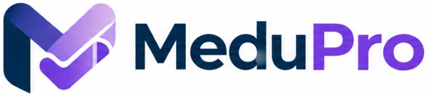
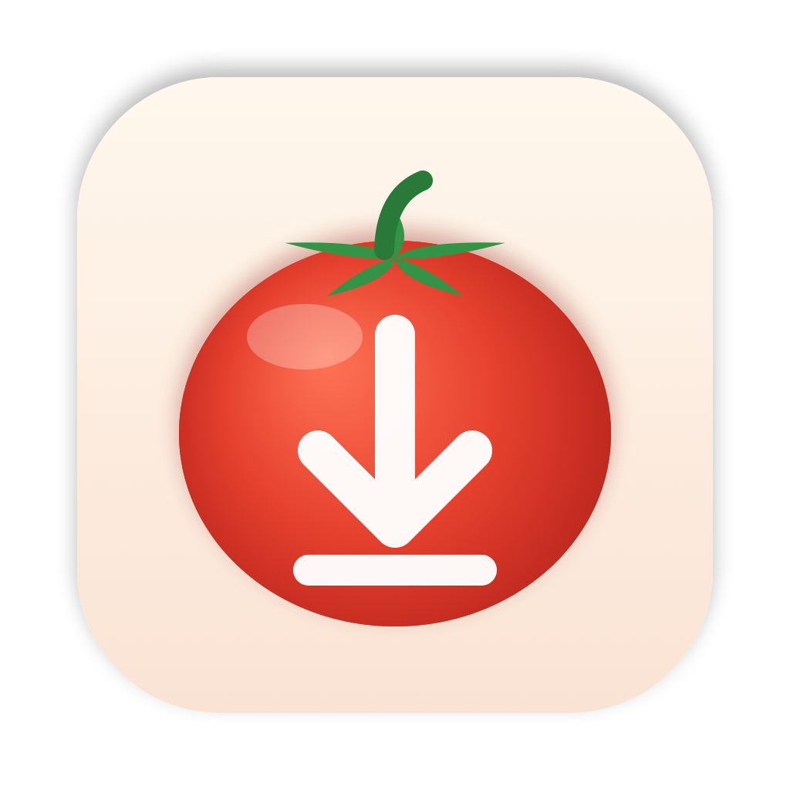
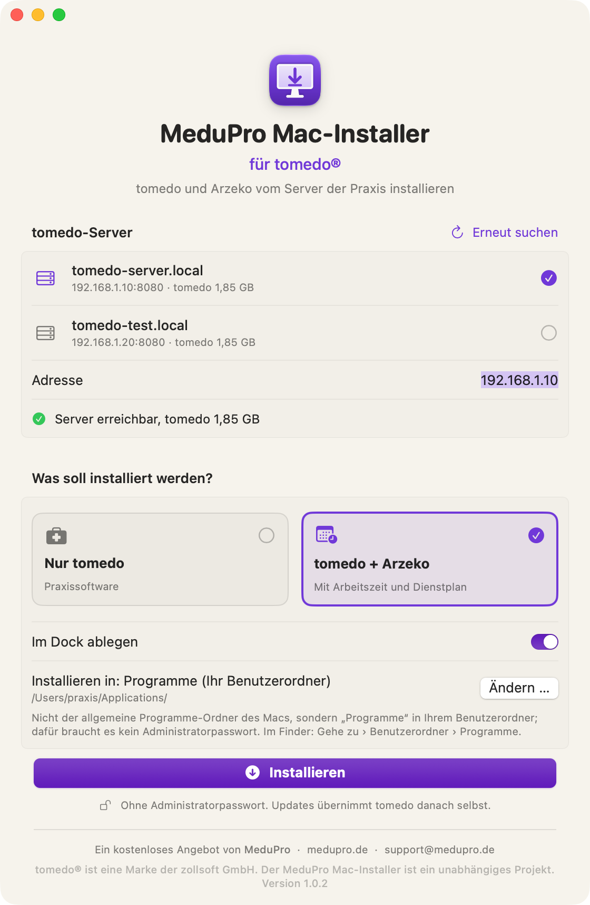

<p align="center">
  <a href="https://medupro.de"></a>
</p>

<p align="center">
  
</p>

<h1 align="center">MeduPro Mac-Installer für tomedo®</h1>

<p align="center">
  <b>Installiert tomedo® und Arzeko auf einem Mac direkt vom tomedo-Server der Praxis.</b>
</p>

<p align="center">
  <a href="https://medupro.de/tomedo-mac-installer/"></a>
</p>

<p align="center">
  
  
  
  
  
</p>

<p align="center">
  <a href="https://medupro.de/tomedo-mac-installer/">Webseite</a> ·
  <a href="mailto:support@medupro.de">Support</a> ·
  <a href="#installation">Installation</a> ·
  <a href="#benutzung">Benutzung</a> ·
  <a href="#fehlerbehebung">Hilfe</a> ·
  <a href="LICENSE">Lizenz</a>
</p>

<p align="center">
  <picture>
    <source media="(prefers-color-scheme: dark)" srcset="docs/screenshot-dark.png">
    
  </picture>
</p>

---

## Wozu

Für einen neuen Arbeitsplatz gibt es bisher drei übliche Wege, den tomedo-Client auf den Mac zu bekommen:

- den Ordner mit tomedo (und Arzeko) von einem vorhandenen Mac kopieren,
- den Client in den Server-Tools unter *Aktionen → Update* herunterladen,
- `http://<server>:8080/tomedo_live/filebyname/serverinternal/tomedo.app.tar` im Browser
  aufrufen und das Archiv entpacken.

Danach muss tomedo an seinen Platz und die Serveradresse eingetragen werden. Arzeko fragt
beim ersten Start ebenfalls nach der Serveradresse
([Handbuch](https://support.tomedo.de/handbuch/arzeko/allgemeines/tomedo-einbinden/)).

Der MeduPro Mac-Installer nimmt den dritten Weg und erledigt den Rest gleich mit:

- sucht im Praxisnetz nach tomedo-Servern und zeigt sie in einer Liste
- lädt tomedo und auf Wunsch Arzeko vom gewählten Server, also die Version, die dort läuft
- legt beide in den Ordner „Programme“ im Benutzerordner (`/Users/<Name>/Applications`), auf Wunsch
  in einen anderen Ordner
- zeigt beim Download Prozent, Größe, Geschwindigkeit und Restzeit
- trägt die Serveradresse für tomedo und Arzeko ein
- legt beide auf Wunsch ins Dock
- braucht kein Administratorpasswort
- überspringt Apps, die schon installiert sind
- prüft den Arzeko-Download per SHA-512

Die App überträgt keine Daten an MeduPro oder Dritte, sie spricht nur mit dem gewählten
tomedo-Server. Updates holt sich tomedo danach wie gewohnt selbst.

## Voraussetzungen

- macOS 14 Sonoma oder neuer, Apple Silicon oder Intel
- Der Mac erreicht den tomedo-Server (Praxisnetz oder VPN)

## Installation

1. Den **MeduPro Mac-Installer** kostenlos auf **[medupro.de/tomedo-mac-installer](https://medupro.de/tomedo-mac-installer/)** herunterladen und das DMG öffnen.
2. **MeduPro Mac-Installer** doppelklicken. Die App kann direkt aus dem DMG laufen.
3. Beim ersten Öffnen meldet macOS, dass die App nicht überprüft werden konnte. Sie ist
   nicht bei Apple notarisiert, sondern nur ad-hoc signiert. So gibst du sie einmalig frei:
   - Meldung mit **Fertig** schließen.
   - **Systemeinstellungen › Datenschutz & Sicherheit** öffnen und ganz nach unten scrollen.
   - Bei „MeduPro Mac-Installer wurde blockiert“ auf **Dennoch öffnen** klicken und bestätigen.
4. Fragt macOS nach dem **lokalen Netzwerk**, bitte **Erlauben**. Sonst findet die App
   den tomedo-Server nicht.

> [!TIP]
> Prüfsumme kontrollieren: `shasum -a 256 MeduPro-Mac-Installer-*.dmg` und mit der
> `.sha256`-Datei vergleichen.

## Benutzung

1. **Server wählen.** Nach wenigen Sekunden stehen alle tomedo-Server im Praxisnetz in der
   Liste. Gibt es genau einen, ist er schon ausgewählt. Steht dein Server nicht dabei, etwa
   weil er über VPN oder auf einem anderen Port läuft, die Adresse eingeben:
   `192.168.1.10`, `server.praxis:8080/tomedo_live/` oder `https://tomedo.praxis.de:8443`.
2. **Nur tomedo** oder **tomedo + Arzeko** wählen.
3. Installationsort prüfen: Vorgabe ist der Ordner „Programme“ in deinem Benutzerordner
   (`/Users/<Name>/Applications`), nicht der allgemeine Programme-Ordner des Macs. Dafür braucht es
   kein Administratorpasswort. Mit **Ändern …** lässt sich ein anderer Ordner wählen.
4. **Installieren**, danach **tomedo öffnen**.
5. In tomedo unter *Einstellungen → Arbeitsplatz → Grundeinstellungen* den Arbeitsplatz
   auswählen oder anlegen ([Handbuch](https://support.tomedo.de/handbuch/tomedo/praxisverwaltung/arbeitsplatz/)).
   Arzeko startet aus tomedo über *Aktion → Arzeko – Arbeitszeitkonto*.

Die App installiert für den **angemeldeten Benutzer**. Für weitere Benutzer einfach unter
deren Konto erneut starten.

<details>
<summary><b>Was genau passiert</b></summary>

| Schritt | Ort |
|---|---|
| Server suchen | HEAD-Anfrage an jede Adresse im eigenen privaten Netz (höchstens /22, sonst /24), Port 8080 |
| tomedo laden | `http://<server>:8080/tomedo_live/filebyname/serverinternal/tomedo.app.tar` |
| Arzeko-Version abfragen | `…/arzeko/latestmac?version=0.0.0&aarch=arm\|intel` |
| Apps ablegen | `~/Applications/tomedo.app`, `~/Applications/Arzeko.app` (oder der gewählte Ordner) |
| Server für tomedo | `defaults read com.zollsoft.tomedo-macOS ZS_ServerAdress` |
| Server für Arzeko | `~/Library/Application Support/Arzeko/usersetting.json` |
| Dock | `com.apple.dock persistent-apps` (vorhandene Einträge bleiben) |
| Eigene Einstellungen | `~/Library/Preferences/de.medupro.mac-installer.plist` |

</details>

## Fehlerbehebung

- **Kein Server in der Liste:** Ist der Mac im Praxisnetz? Wurde der Zugriff auf das
  lokale Netzwerk erlaubt (Systemeinstellungen › Datenschutz & Sicherheit › Lokales
  Netzwerk)? Server per VPN bitte von Hand eingeben.
- **„Server nicht erreichbar“:** Startet ein Download, wenn man
  `http://<server>:8080/tomedo_live/filebyname/serverinternal/tomedo.app.tar` im Browser aufruft?
  Wenn nicht, ist der Server von diesem Mac aus nicht erreichbar.
- **„liefert kein tomedo aus (HTTP 404)“:** Port oder Pfad stimmen nicht.
- **Neu installieren:** `tomedo.app` im Installationsort (Vorgabe `~/Applications`) in den Papierkorb legen und erneut starten.
- **Protokoll:** Konsole.app öffnen und nach `de.medupro.mac-installer` filtern.

Hilfe gibt es unter **[support@medupro.de](mailto:support@medupro.de)**. Im Fehlerfall füllt
der Knopf **Support kontaktieren** die Mail schon mit den nötigen Angaben.

## Entwicklung

```bash
swift test                                              # Tests
MACINSTALLER_TEST_SERVER=192.168.1.10 swift test              # zusätzlich gegen echten Server (installiert nichts)
MACINSTALLER_TEST_SERVER=… MACINSTALLER_TEST_INSTALL=1 swift test   # Ende-zu-Ende in Wegwerf-Ordner
swift run MacInstaller                               # App ohne Bundle starten
MACINSTALLER_EXTRA_NETWORKS=192.168.10.0/24 swift run MacInstaller   # zusätzlich ein entferntes Netz durchsuchen
MACINSTALLER_DEMO=1 MACINSTALLER_APPEARANCE=dark swift run MacInstaller    # Vorführmodus für Bildschirmfotos
scripts/build-app.sh                                    # dist/: .app, .zip, .dmg, .sha256
swift scripts/make-icon.swift Resources/AppIcon-1024.png   # Symbol neu zeichnen
```

| Ordner | Inhalt |
|---|---|
| `Sources/MacInstallerCore` | Installationslogik ohne Oberfläche: Adressen, Serversuche, Download, Entpacken, Konfiguration, Dock |
| `Sources/MacInstaller` | SwiftUI-Oberfläche |
| `Tests/MacInstallerCoreTests` | Swift Testing, inklusive optionaler Echttests |
| `scripts/` | Build, Signatur, DMG und App-Symbol |

## Lizenz und Marken

Quelltext einsehbar, **alle Rechte vorbehalten**. Die veröffentlichte App ist kostenlos
nutzbar, auch in Praxen. Weitergabe und Änderungen nur mit Zustimmung, siehe [LICENSE](LICENSE).

Woher die Angaben über tomedo, Arzeko und das Dock stammen, steht in
[docs/quellen.md](docs/quellen.md).

tomedo® ist eine eingetragene Marke der zollsoft GmbH. Der MeduPro Mac-Installer ist ein
unabhängiges Projekt von MeduPro und steht in keiner Verbindung zur zollsoft GmbH.

---

<p align="center">
  <a href="https://medupro.de"></a><br>
  <sub>Ein kostenloses Angebot von <a href="https://medupro.de">MeduPro</a> · <a href="mailto:support@medupro.de">support@medupro.de</a> · <a href="https://github.com/MeduPro/mac-installer">github.com/MeduPro/mac-installer</a></sub>
</p>
